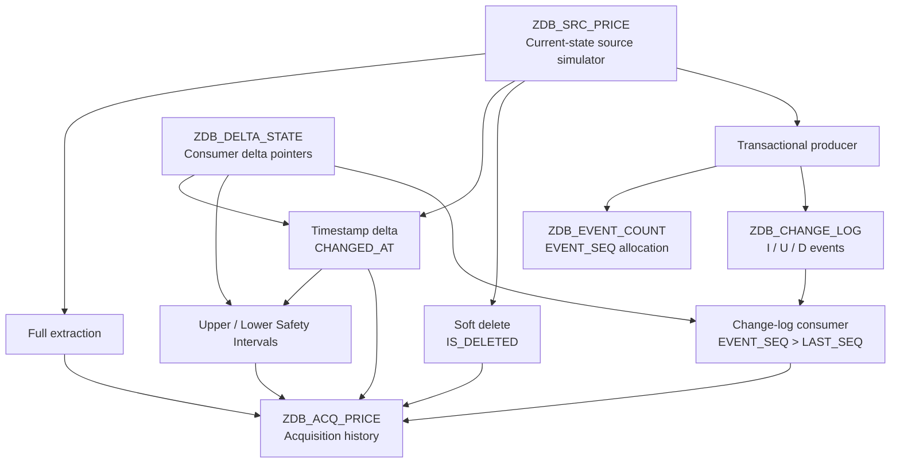

# ABAP Cloud Database Acquisition Lab

ABAP Cloud laboratory for studying database acquisition and generic delta semantics.

## Purpose

This project explores the reliability properties of database-based data acquisition.

The focus is not on reproducing the SAP BW DB Connect runtime, but on studying the source-side and consumer-side semantics that determine whether a database delta is reliable.

The laboratory covers:

- full extraction;
- numeric delta based on a creation sequence;
- timestamp-based delta;
- delayed COMMIT and transaction visibility;
- upper and lower safety intervals;
- physical and soft deletes;
- transactional change logs;
- monotonic event sequencing;
- producer concurrency;
- consumer restart;
- transactional rollback and recovery.

The project was built in SAP BTP ABAP Environment and uses local ABAP Cloud tables to simulate an external database source.

## Scope and Limitations

This project does **not** implement SAP BW DB Connect.

It does not contain:

- a DB Connect source system;
- BW DataSources;
- InfoPackages;
- PSA runtime;
- DTPs;
- ADSOs;
- Process Chains;
- a real external Oracle, SQL Server, DB2, PostgreSQL, or other remote database connection.

Instead, `ZDB_SRC_PRICE` acts as a controlled current-state source table so that delta behavior can be reproduced and tested deterministically.

The project concentrates on the semantic boundary:

```text
database source
      |
      v
delta extraction logic
      |
      v
acquisition persistence
```

## Architecture

The laboratory uses `ZDB_SRC_PRICE` as a controlled current-state source table that represents an external database table or view.

Two alternative delta architectures are implemented on top of this source:

1. **Timestamp-based delta**
2. **Transactional change-log delta**

Both approaches persist extracted data in `ZDB_ACQ_PRICE`, which acts as a lightweight acquisition-history layer for the laboratory.



## Experiments

The project is organized around a sequence of controlled experiments.

Each experiment starts from a simple acquisition strategy, introduces a specific source-side or transaction failure mode, and observes whether the consumer can still advance its delta pointer without losing data.


### 1. Full Extraction

The initial baseline reads the complete current-state source table:

```text
ZDB_SRC_PRICE
      |
      | FULL SELECT
      v
ZDB_ACQ_PRICE

```

### 2. Numeric Delta on a Current-State Table

The first delta strategy uses the monotonically increasing source field `CREATED_SEQ`.

The consumer stores the last successfully processed value in `LAST_SEQ` and reads only rows satisfying:

```text
CREATED_SEQ > LAST_SEQ
```

The source is initially prepared with the following current-state records:

```text
P1001/SOUTH  CREATED_SEQ = 1001
P1002/SOUTH  CREATED_SEQ = 1002
P1003/SOUTH  CREATED_SEQ = 1003
P1001/NORTH  CREATED_SEQ = 1004
```

The numeric delta pointer is then initialized to:

```text
LAST_SEQ = 1004
```

Two source changes are performed in one transaction.

A new row is inserted:

```text
P1004/SOUTH
PRICE       = 40.00
CREATED_SEQ = 1005
```

An existing row is also updated:

```text
P1001/SOUTH
PRICE       10.00 -> 12.00
CREATED_SEQ remains 1001
```

The numeric delta reader selects:

```text
CREATED_SEQ > 1004
```

and therefore returns only:

```text
P1004/SOUTH
CREATED_SEQ = 1005
```

The update of `P1001/SOUTH` is not detected because its creation sequence does not change.

Result:

```text
INSERT -> detected
UPDATE -> not detected
```

The experiment demonstrates that a monotonically increasing creation sequence is suitable for append-only acquisition, but is not sufficient for a mutable current-state table.

The important distinction is:

```text
CREATED_SEQ
= identity/order of row creation

not

= identity/order of every business change
```

After the successful acquisition, the consumer pointer advances from:

```text
LAST_SEQ = 1004
```

to:

```text
LAST_SEQ = 1005
```

Only data actually persisted in the acquisition layer is allowed to advance the pointer.
### 3. Timestamp Delta

The second delta strategy uses the source field `CHANGED_AT`.

Unlike `CREATED_SEQ`, this field is updated whenever a relevant source row is inserted or changed.

The source is first prepared with a common baseline timestamp:

```text
CHANGED_AT = T0
```

for all existing rows.

The timestamp delta pointer is then initialized to:

```text
LAST_CHANGED_AT = T0
```

Two source changes are performed in one transaction.

An existing row is updated:

```text
P1001/SOUTH
PRICE       12.00 -> 13.00
CREATED_SEQ remains 1001
CHANGED_AT  = T1
```

A new row is also inserted:

```text
P1005/SOUTH
PRICE       = 50.00
CREATED_SEQ = 1006
CHANGED_AT  = T1
```

Both changes intentionally receive the same timestamp.

The timestamp delta reader selects:

```text
CHANGED_AT > LAST_CHANGED_AT
```

and therefore returns both rows:

```text
P1001/SOUTH
PRICE      = 13.00
CHANGED_AT = T1

P1005/SOUTH
PRICE      = 50.00
CHANGED_AT = T1
```

Result:

```text
INSERT -> detected
UPDATE -> detected
```

The important difference from the numeric creation-sequence delta is that the existing row `P1001/SOUTH` is detected even though:

```text
CREATED_SEQ = 1001
```

remains unchanged.

The delta criterion is now based on the time of the latest relevant modification rather than on the time or order of row creation.

The experiment demonstrates that timestamp-based delta can detect both inserts and updates on a mutable current-state table, provided that the source reliably updates `CHANGED_AT` for every relevant business change.

After the successful acquisition, the consumer pointer advances from:

```text
LAST_CHANGED_AT = T0
```

to:

```text
LAST_CHANGED_AT = T1
```

The implementation stores the acquired rows and advances the timestamp pointer in the same database transaction.

At this stage the algorithm is intentionally naive:

```text
CHANGED_AT > LAST_CHANGED_AT
```

No safety interval is used yet.

This makes the reader suitable for demonstrating the next failure mode: a source change may receive an earlier `CHANGED_AT` value but become visible only after a delayed `COMMIT`, allowing the consumer pointer to advance past it.

### 4. Delayed COMMIT Failure

A two-session experiment is used to demonstrate a failure mode of the naive timestamp-delta algorithm.

The consumer currently uses:

```text
CHANGED_AT > LAST_CHANGED_AT
```

with no safety interval.

The initial consumer pointer is:

```text
LAST_CHANGED_AT = T0
```

In Session B, an existing source row is updated:

```text
P1002/SOUTH
PRICE       20.00 -> 23.00
CHANGED_AT  = T1
```

The transaction is intentionally paused before `COMMIT`.

At this point the row has already received `CHANGED_AT = T1`, but the updated version is not yet visible to other sessions.

While Session B is still uncommitted, Session A inserts another row and commits immediately:

```text
P1008/SOUTH
PRICE       = 80.00
CHANGED_AT  = T2
```

with:

```text
T1 < T2
```

The naive timestamp reader runs in Session A.

It can see the committed row at `T2`, but it cannot see the still-uncommitted update at `T1`.

The reader therefore selects:

```text
P1008/SOUTH
CHANGED_AT = T2
```

and advances the consumer pointer to:

```text
LAST_CHANGED_AT = T2
```

Session B is then resumed and commits the older change:

```text
P1002/SOUTH
CHANGED_AT = T1
```

The row is now committed and visible, but its timestamp is already behind the consumer pointer:

```text
T1 < LAST_CHANGED_AT = T2
```

The next timestamp-delta request uses:

```text
CHANGED_AT > T2
```

and therefore does not select `P1002/SOUTH`.

Result:

```text
P1008/SOUTH -> acquired
P1002/SOUTH -> permanently missed
```

The failure is not caused by an incorrect source timestamp.

`P1002/SOUTH` received a valid `CHANGED_AT = T1` before the transaction committed.

The problem is that:

```text
time of change
!=
time at which the change becomes visible to the extractor
```

The experiment demonstrates that a naive timestamp delta can lose committed source changes when transaction visibility is delayed.

The critical sequence is:

```text
T1
P1002 updated
CHANGED_AT = T1
transaction still uncommitted

T2
P1008 inserted and committed

consumer reads source
P1008 is visible
P1002 is not visible

consumer pointer -> T2

later
P1002 commits with CHANGED_AT = T1

next request:
CHANGED_AT > T2

P1002 is never selected
```

Changing the selection condition from:

```text
CHANGED_AT > LAST_CHANGED_AT
```

to:

```text
CHANGED_AT >= LAST_CHANGED_AT
```

does not solve this failure mode because:

```text
T1 < T2
```

rather than:

```text
T1 = T2
```

This experiment motivates the use of an upper safety interval.


### 5. Upper Safety Interval

The delayed-COMMIT experiment shows that a naive timestamp delta can advance its pointer beyond a source change that is still uncommitted and therefore temporarily invisible.

To reduce this risk, the safer timestamp reader introduces an upper safety interval.

Instead of reading up to the current request time, the reader defines:

```text
UPPER_BOUND =
REQUEST_START - UPPER_SAFETY_INTERVAL
```

For example:

```text
REQUEST_START          = 12:30:00
UPPER_SAFETY_INTERVAL  = 00:05:00

UPPER_BOUND            = 12:25:00
```

The consumer then reads only:

```text
LAST_CHANGED_AT < CHANGED_AT <= UPPER_BOUND
```

All source changes newer than `UPPER_BOUND` remain temporarily outside the extraction window.

This creates a deliberate safety zone:

```text
                         safety zone
                             |
                             v
-----------------------------|-------------------->
                       UPPER_BOUND           REQUEST_START
```

The delayed-COMMIT experiment is repeated.

Session B performs:

```text
P1002/SOUTH
PRICE       20.00 -> 23.00
CHANGED_AT  = T1
```

and pauses before `COMMIT`.

Session A then inserts and commits:

```text
P1008/SOUTH
PRICE       = 80.00
CHANGED_AT  = T2
```

with:

```text
T1 < T2
```

Both timestamps are still inside the upper safety zone when the safe reader runs.

Therefore the reader does not select either row yet.

Instead, it advances the persistent pointer only to the safe upper boundary:

```text
LAST_CHANGED_AT = UPPER_BOUND
```

The important difference from the naive reader is that the pointer is no longer derived from:

```text
MAX(CHANGED_AT) of currently visible rows
```

It represents:

```text
the latest time boundary that has been safely scanned
```

Session B is then allowed to commit.

After enough time has passed, the next request calculates a later `UPPER_BOUND`.

Both source changes now fall inside the safe extraction interval:

```text
LAST_CHANGED_AT < T1 <= UPPER_BOUND
LAST_CHANGED_AT < T2 <= UPPER_BOUND
```

and both rows are acquired successfully.

Result:

```text
Naive timestamp delta
-> late-committed row lost

Timestamp delta with upper safety
-> late-committed row acquired later
```

The experiment demonstrates that the upper safety interval protects the consumer from advancing too close to the current time, where source transactions may still be incomplete.

The trade-off is additional latency:

```text
larger upper safety interval
-> stronger protection against delayed visibility
-> older data delivered to the consumer
```

The configured interval must therefore be compatible with the source transaction behavior.

For the timestamp architecture to be reliable, the delay between:

```text
assigning CHANGED_AT
and
the transaction becoming committed and visible
```

must be bounded.

The upper safety interval must be large enough to cover that expected visibility lag.

If source transactions can remain uncommitted for an arbitrarily long time, no finite upper safety interval can provide a strict lossless guarantee.

This limitation is one of the main differences between timestamp-based delta and the transactional change-log architecture explored later in the project.

### 6. Lower Safety Interval

The upper safety interval protects the consumer from reading too close to the current time.

A lower safety interval addresses a different problem: it intentionally re-reads part of the time range that was already considered processed.

Without a lower safety interval, the next request starts strictly after the persistent pointer:

```text
LAST_CHANGED_AT < CHANGED_AT <= UPPER_BOUND
```

With a lower safety interval, the reader calculates:

```text
LOWER_BOUND =
LAST_CHANGED_AT - LOWER_SAFETY_INTERVAL
```

and reads:

```text
LOWER_BOUND < CHANGED_AT <= UPPER_BOUND
```

For example:

```text
LAST_CHANGED_AT        = 10:04:51
LOWER_SAFETY_INTERVAL  = 00:05:00

LOWER_BOUND            = 09:59:51
```

The interval:

```text
09:59:51 < CHANGED_AT <= 10:04:51
```

has already been covered by an earlier request, but it is intentionally read again.

This creates an overlap between consecutive extraction windows:

```text
Previous request
-----------------------------> LAST_CHANGED_AT
                         |
                         | already scanned
                         |
                  <------+
                  overlap
                  |
                  v
LOWER_BOUND ------------------------------> new UPPER_BOUND
               Next request
```

The persistent pointer itself is **not** moved backwards.

`LOWER_BOUND` is only a temporary selection boundary.

After the request completes successfully, the pointer still advances forward to the new safe upper boundary:

```text
LAST_CHANGED_AT = UPPER_BOUND
```

In the laboratory, previously acquired rows such as:

```text
P1002/SOUTH
P1008/SOUTH
```

fall inside the lower overlap and are therefore selected again in a later acquisition run.

Result:

```text
same business after-image
-> acquired in more than one run
```

This duplicate acquisition is intentional.

For after-image semantics, repeated delivery is normally safe.

For example, if the consumer receives:

```text
P1002/SOUTH
PRICE = 23.00
```

twice, the downstream state remains:

```text
PRICE = 23.00
```

The second delivery overwrites the target with the same state.

The important principle is:

```text
controlled duplicate delivery
is preferable to
an irreversible delta gap
```

This makes lower safety particularly suitable for after-image based acquisition.

However, the same approach would require additional protection for additive semantics.

For example:

```text
SALES_AMOUNT += 100
```

applied twice would incorrectly produce:

```text
SALES_AMOUNT += 200
```

Therefore overlap safety must always be evaluated together with the downstream record semantics.

The lower safety interval complements the upper safety interval:

```text
Upper safety
-> delays very recent changes
-> avoids advancing too close to unfinished source transactions

Lower safety
-> re-reads a small part of the already scanned past
-> creates controlled overlap and duplicate acquisition
```

Together they define the effective timestamp extraction window:

```text
LOWER_BOUND < CHANGED_AT <= UPPER_BOUND
```

where:

```text
LOWER_BOUND =
LAST_CHANGED_AT - LOWER_SAFETY_INTERVAL

UPPER_BOUND =
REQUEST_START - UPPER_SAFETY_INTERVAL
```

The laboratory uses five-minute values for both intervals only to make the experiments easy to reproduce.

These values are not production recommendations.

In a real implementation, the intervals must be chosen according to the source transaction and visibility behavior.

Lower safety also does not remove the fundamental requirement that source visibility lag must be bounded.

If a transaction becomes visible only after the consumer has moved beyond both:

```text
the upper safety zone
and
the lower overlap window
```

the timestamp-based architecture can still lose the change.

The experiment therefore demonstrates that safety intervals reduce the risk of timestamp-boundary failures, but they do not replace a reliable source-side timing contract.

### 7. Physical vs Soft Delete

Timestamp-based delta reads changes from the current-state source table by evaluating `CHANGED_AT`.

This creates an important problem for physical deletes.

A physical delete removes the source row completely:

```text
DELETE FROM source
WHERE PRODUCT_ID = 'P1003'
  AND STORE_GROUP = 'SOUTH'
```

After the delete, the row no longer exists in `ZDB_SRC_PRICE`.

The timestamp reader can only select rows that are still present:

```text
LOWER_BOUND < CHANGED_AT <= UPPER_BOUND
```

but a physically deleted row has no remaining `CHANGED_AT` value to evaluate.

The experiment performs a physical delete of:

```text
P1003/SOUTH
```

Result:

```text
source row removed
timestamp delta selects 0 rows
consumer receives no deletion information
```

The delta pointer can still move forward normally, even though a real business change has occurred.

This demonstrates an important limitation of current-state timestamp delta:

```text
INSERT -> visible
UPDATE -> visible
physical DELETE -> invisible
```

The problem is not caused by the timestamp value.

The problem is that the source row no longer exists.

To make deletion visible to timestamp delta, the project uses a soft-delete convention.

The deleted business object remains physically present in the source table and is marked with:

```text
IS_DELETED = 'X'
```

At the same time:

```text
CHANGED_AT = current timestamp
```

is assigned.

The source row therefore becomes an ordinary changed after-image:

```text
P1003/SOUTH
PRICE       = 30.00
IS_DELETED  = X
CHANGED_AT  = T1
```

The timestamp reader can now select the row normally:

```text
LOWER_BOUND < T1 <= UPPER_BOUND
```

and the acquisition layer receives the deletion marker.

Result:

```text
Soft DELETE
-> source row remains
-> CHANGED_AT changes
-> timestamp delta detects the row
-> IS_DELETED carries deletion semantics downstream
```

The deletion marker can then be propagated through later storage layers and interpreted according to the contract of each layer.

For example:

```text
IS_DELETED = ''
-> insert or update current business state

IS_DELETED = 'X'
-> delete, deactivate, or close validity
```

The important distinction is:

```text
CHANGED_AT
= tells the consumer that the row changed

IS_DELETED
= tells the consumer what the change means
```

The soft-delete approach fits naturally with timestamp-based after-image acquisition because the deletion marker travels together with the source row.

The trade-off is that deleted business objects must remain physically stored as tombstone records until they can be safely archived or removed according to a separate retention policy.

The experiment therefore demonstrates:

```text
Physical DELETE
-> invisible to current-state timestamp delta

Soft DELETE
-> visible as a normal timestamped after-image
```

This is the deletion strategy used by the timestamp-based architecture in this laboratory.

A different solution is explored later with the transactional change-log architecture, where physical deletes are represented explicitly as `D` events and no tombstone row is required in the current-state table.

### 8. Transactional Change Log

The second delta architecture does not derive changes from the current-state table.

Instead, every relevant business change is recorded explicitly in a separate transactional change log.

The source still maintains the current business state in:

```text
ZDB_SRC_PRICE
```

but changes are additionally written to:

```text
ZDB_CHANGE_LOG
```

Each log entry contains:

```text
EVENT_SEQ
PRODUCT_ID
STORE_GROUP
OPERATION
PRICE
CURRENCY
EVENT_AT
```

The operation field describes the business event:

```text
I = INSERT
U = UPDATE
D = DELETE
```

Unlike `CREATED_SEQ` in the current-state table, `EVENT_SEQ` identifies a change event rather than a business object.

For example:

```text
1001  P1010  SOUTH  I  100.00
1002  P1001  SOUTH  U   14.00
1003  P1011  SOUTH  I  110.00
1004  P1010  SOUTH  D
```

This allows multiple changes to the same business key to be represented independently and in order.

The producer maintains the next event number in:

```text
ZDB_EVENT_COUNT
```

The important requirement is that the following three operations belong to the same database transaction:

```text
1. Advance the event counter
2. Apply the business change to ZDB_SRC_PRICE
3. Insert the corresponding event into ZDB_CHANGE_LOG
```

The producer therefore follows the pattern:

```text
lock event counter
        |
        v
read LAST_EVENT_SEQ
        |
        v
allocate next EVENT_SEQ
        |
        v
update ZDB_EVENT_COUNT
        |
        v
apply INSERT / UPDATE / DELETE to ZDB_SRC_PRICE
        |
        v
insert I / U / D event into ZDB_CHANGE_LOG
        |
        v
COMMIT
        |
        v
release lock
```

If any database operation fails before `COMMIT`, the entire producer LUW is rolled back.

The business state, event counter, and change log therefore remain consistent.

For example, an update is represented as:

```text
Current state:

P1001/SOUTH
PRICE = 14.00
```

together with:

```text
Change log:

1002
P1001/SOUTH
OPERATION = U
PRICE     = 14.00
```

A physical delete can also be represented explicitly.

The current-state row is removed:

```text
P1010/SOUTH
-> physically deleted from ZDB_SRC_PRICE
```

while the same transaction writes:

```text
1004
P1010/SOUTH
OPERATION = D
```

to `ZDB_CHANGE_LOG`.

This means that the current-state table does not need to retain a tombstone row for the deleted object.

The consumer has its own independent delta pointer in:

```text
ZDB_DELTA_STATE
```

For the change-log source:

```text
SOURCE_NAME = PRODUCT_PRICE_LOG
LAST_SEQ    = last successfully acquired EVENT_SEQ
```

The consumer reads:

```text
EVENT_SEQ > LAST_SEQ
ORDER BY EVENT_SEQ
```

The first consumer run in the laboratory starts with:

```text
LAST_SEQ = 1000
```

and acquires:

```text
1001  P1010  I
1002  P1001  U
1003  P1011  I
```

The consumer then advances:

```text
LAST_SEQ = 1003
```

A later physical delete creates:

```text
1004  P1010  D
```

and the same unchanged consumer logic acquires it using:

```text
EVENT_SEQ > 1003
```

Result:

```text
INSERT -> explicit I event
UPDATE -> explicit U event
DELETE -> explicit D event
```

The important architectural difference from timestamp delta is that the consumer no longer infers change semantics from the current-state table.

Instead, the source publishes an ordered event stream.

The delta criterion becomes:

```text
EVENT_SEQ > LAST_SEQ
```

rather than:

```text
CHANGED_AT > LAST_CHANGED_AT
```

This removes the need for timestamp safety windows, provided that event sequencing and transaction commit order are kept consistent.

The reliability of this architecture therefore depends on a different contract:

```text
Timestamp delta
-> correctness depends on a bounded timing / visibility contract

Transactional change log
-> correctness depends on transactional coupling
   and ordered event publication
```

The following experiments test these requirements explicitly:
producer concurrency, consumer restart, and rollback when change-log persistence fails.

### 9. Producer Concurrency

A monotonically increasing `EVENT_SEQ` is not sufficient by itself.

The sequence must also remain consistent with the order in which producer transactions become committed and visible.

Without synchronization, two producer sessions could behave like this:

```text
Session A
allocate EVENT_SEQ = 1002
business change prepared
log event prepared
COMMIT delayed
```

while another session continues:

```text
Session B
allocate EVENT_SEQ = 1003
business change prepared
log event prepared
COMMIT immediately
```

This would create the dangerous situation:

```text
1003 committed and visible
while
1002 is still uncommitted
```

A consumer using:

```text
EVENT_SEQ > LAST_SEQ
```

could then read `1003`, advance its pointer, and permanently skip `1002` when Session A commits later.

Therefore event allocation must be serialized.

The project uses the lock object:

```text
EZDBEVCOUNT
```

to protect the counter row in:

```text
ZDB_EVENT_COUNT
```

for:

```text
SOURCE_NAME = PRODUCT_PRICE_LOG
```

The producer acquires the lock before reading and advancing the event counter.

The lock is held until after the complete producer transaction is committed.

The producer sequence is therefore:

```text
ENQUEUE EZDBEVCOUNT
        |
        v
read LAST_EVENT_SEQ
        |
        v
allocate next EVENT_SEQ
        |
        v
update event counter
        |
        v
apply business change
        |
        v
insert change-log event
        |
        v
COMMIT
        |
        v
DEQUEUE
```

A two-session experiment verifies this behavior.

Session A acquires the lock and allocates:

```text
EVENT_SEQ = 1002
```

It then prepares the business update and change-log event but pauses before `COMMIT`.

At this point:

```text
counter change      -> uncommitted
business change     -> uncommitted
change-log event    -> uncommitted
counter lock        -> still held
```

While Session A is paused, Session B attempts to produce another event.

Session B cannot acquire `EZDBEVCOUNT` and receives a foreign-lock condition.

It does not receive a new event number and does not change:

```text
ZDB_EVENT_COUNT
ZDB_SRC_PRICE
ZDB_CHANGE_LOG
```

Session A is then resumed and commits event `1002`.

Only after the lock is released can Session B run again.

The second attempt succeeds and allocates:

```text
EVENT_SEQ = 1003
```

The observed order is therefore:

```text
allocation order:
1002 -> 1003

commit order:
1002 -> 1003

visibility order:
1002 -> 1003
```

The dangerous order:

```text
1003 committed before 1002
```

cannot occur as long as all producers follow the same lock protocol.

The experiment demonstrates an important property:

```text
monotonic numbering alone
is not enough
```

What is required is:

```text
monotonic EVENT_SEQ
+
producer serialization
+
transactional commit ordering
```

Only then can `EVENT_SEQ` be used safely as a high-water-mark delta pointer.

The reliability contract therefore includes the rule:

```text
Every producer that writes to PRODUCT_PRICE_LOG
must acquire EZDBEVCOUNT before allocating EVENT_SEQ.
```

If any producer bypasses this protocol and writes directly to the event counter or change log, the ordering guarantee is lost.

### 10. Consumer Restart

The change-log consumer maintains its own independent pointer:

```text
ZDB_DELTA_STATE
SOURCE_NAME = PRODUCT_PRICE_LOG
LAST_SEQ    = last successfully acquired EVENT_SEQ
```

The consumer reads committed events using:

```text
EVENT_SEQ > LAST_SEQ
ORDER BY EVENT_SEQ
```

and then performs two persistence steps in the same database LUW:

```text
1. Persist acquired events in ZDB_ACQ_PRICE
2. Advance consumer LAST_SEQ
```

Only after both operations succeed is:

```text
COMMIT WORK
```

executed.

This creates an important restart invariant:

```text
acquisition persistence
+
consumer pointer advancement
=
one atomic transaction
```

The laboratory verifies this by intentionally interrupting the consumer after the acquired events have been inserted into `ZDB_ACQ_PRICE`, but before the consumer pointer is updated and before `COMMIT`.

Before the experiment, the consumer state is:

```text
LAST_SEQ = 1004
```

and the producer has already committed two later events:

```text
1005  P1001/SOUTH  U  14.00
1006  P1001/SOUTH  U  15.00
```

The consumer selects both events:

```text
EVENT_SEQ > 1004
```

and prepares them for persistence in one acquisition run.

Execution is then intentionally terminated before the final commit.

Because the LUW has not been committed, the partial consumer work is rolled back.

After termination:

```text
ZDB_CHANGE_LOG
-> events 1005 and 1006 still exist

ZDB_ACQ_PRICE
-> no committed acquisition rows for 1005 and 1006

ZDB_DELTA_STATE
-> LAST_SEQ remains 1004
```

This is the required restart-safe state.

The producer events remain durable because they were committed independently before the consumer started.

The consumer pointer also remains unchanged because the failed consumer LUW never committed.

The same consumer is then started again.

It again selects:

```text
1005
1006
```

using:

```text
EVENT_SEQ > 1004
```

The retry succeeds and commits both the acquired events and the new pointer.

The final state becomes:

```text
ZDB_ACQ_PRICE
-> 1005 persisted
-> 1006 persisted

ZDB_DELTA_STATE
-> LAST_SEQ = 1006
```

Result:

```text
consumer interrupted before COMMIT
        |
        v
acquisition rows rolled back
consumer pointer unchanged
        |
        v
same committed source events selected again
        |
        v
successful retry
        |
        v
events persisted
pointer advanced
```

The experiment demonstrates that the consumer can safely restart after an interrupted acquisition without losing committed events.

The critical rule is:

```text
Never advance the consumer pointer
before the corresponding acquired data
has been successfully persisted.
```

If the implementation instead performed:

```text
advance LAST_SEQ
COMMIT

then later

persist acquired events
```

a crash between these steps could permanently lose events.

The project therefore uses the opposite order:

```text
persist events
        |
        v
advance LAST_SEQ
        |
        v
COMMIT both together
```

This gives the consumer replay semantics:

```text
before COMMIT
-> the same events may be read again

after COMMIT
-> the pointer moves past them
```

The change log therefore acts as the durable replay source, while `LAST_SEQ` represents only the highest event sequence that the consumer has successfully committed to its acquisition layer.

### 11. Producer Rollback on Log Failure

The transactional change-log producer must keep three source-side changes consistent:

```text
1. Advance ZDB_EVENT_COUNT
2. Apply the business change to ZDB_SRC_PRICE
3. Insert the corresponding event into ZDB_CHANGE_LOG
```

All three operations are executed in the same database LUW.

The intended producer pattern is:

```text
lock event counter
        |
        v
allocate EVENT_SEQ
        |
        v
update ZDB_EVENT_COUNT
        |
        v
apply business change
        |
        v
insert event into ZDB_CHANGE_LOG
        |
        v
COMMIT
```

If the change-log insert fails, the producer must not leave either the business row or the event counter in a partially updated state.

The laboratory verifies this requirement by creating a deliberate duplicate-key conflict for the next event sequence.

Assume the current producer counter is:

```text
LAST_EVENT_SEQ = 1006
```

The failure-preparation class inserts an artificial conflict record:

```text
EVENT_SEQ   = 1007
PRODUCT_ID  = PFAIL
STORE_GROUP = TEST
```

into `ZDB_CHANGE_LOG`.

The producer counter itself remains unchanged:

```text
LAST_EVENT_SEQ = 1006
```

The normal producer is then started.

It acquires the counter lock and allocates:

```text
EVENT_SEQ = 1007
```

Within the same LUW it performs:

```text
ZDB_EVENT_COUNT
1006 -> 1007
```

and applies the business change:

```text
P1001/SOUTH
PRICE 15.00 -> 16.00
```

The producer then attempts to insert the real event:

```text
1007
P1001/SOUTH
OPERATION = U
PRICE     = 16.00
```

into `ZDB_CHANGE_LOG`.

This insert fails because the artificial record already occupies the primary key for:

```text
PRODUCT_PRICE_LOG + EVENT_SEQ 1007
```

The producer error branch executes:

```text
ROLLBACK WORK
```

The complete producer LUW is therefore reversed.

After the rollback:

```text
ZDB_EVENT_COUNT
LAST_EVENT_SEQ = 1006
```

The business row is restored:

```text
P1001/SOUTH
PRICE = 15.00
```

and the real change-log event is not created.

The only remaining `1007` row is the artificial conflict record that had been committed before the producer transaction started.

Result:

```text
counter update
+
business update
+
change-log insert failure
        |
        v
ROLLBACK
        |
        +--> counter restored
        +--> business state restored
        +--> real event not created
```

The artificial conflict is then removed by the cleanup class.

The producer is started again.

Because the failed transaction did not commit the counter advancement, the producer allocates the same sequence again:

```text
EVENT_SEQ = 1007
```

The retry now succeeds:

```text
ZDB_EVENT_COUNT
1006 -> 1007

ZDB_SRC_PRICE
P1001/SOUTH
15.00 -> 16.00

ZDB_CHANGE_LOG
1007  P1001/SOUTH  U  16.00
```

The consumer subsequently reads:

```text
EVENT_SEQ > 1006
```

and acquires event `1007` normally.

This experiment demonstrates that producer reliability depends on keeping:

```text
event-sequence allocation
+
business change
+
change-log event
```

inside the same database transaction.

The event counter must not be committed independently from the business change or the log event.

Otherwise a failure could create states such as:

```text
counter advanced
but
business change rolled back
```

or:

```text
business change committed
but
change-log event missing
```

Either case would break the reliability of the delta stream.

The lock object and the database transaction therefore serve different purposes:

```text
EZDBEVCOUNT
-> preserves producer ordering across concurrent sessions

COMMIT / ROLLBACK
-> preserves atomic consistency of counter, business state, and log event
```

Together they provide the source-side guarantee required for reliable `EVENT_SEQ`-based acquisition.

## Timestamp Delta vs Transactional Change Log

The laboratory implements two different approaches to reliable database delta acquisition:

1. timestamp-based delta on a mutable current-state table;
2. transactional change-log delta based on an ordered event stream.

Both approaches can be correct, but they rely on different source-side contracts.

| Criterion | `CHANGED_AT + IS_DELETED` | Transactional Change Log |
|---|---|---|
| **Correctness foundation** | Timing contract: `CHANGED_AT` and configured safety intervals must cover the delay until a change becomes committed and visible | Transaction and ordering contract: business change and log event are committed atomically, and events are published in commit-consistent sequence order |
| **Dependency on source transaction duration** | Yes. Safety intervals must be large enough to cover the maximum expected commit / visibility lag | For delta correctness, effectively no dependency on transaction duration |
| **Arbitrarily long delayed COMMIT** | No finite safety interval can provide a strict guarantee if visibility lag is unbounded | The event remains invisible until commit and cannot be skipped by a later event when producer ordering is enforced |
| **Protection cost** | Additional latency and intentional overlap | More complex producer logic, event log maintenance, and serialized event-sequence allocation |
| **INSERT** | Detected through a new `CHANGED_AT` value | Explicit `I` event |
| **UPDATE** | Detected if every relevant update changes `CHANGED_AT` | Explicit `U` event |
| **Physical DELETE** | Not visible because the source row disappears | Explicit `D` event |
| **Delete strategy** | Requires `IS_DELETED` or another tombstone convention | Physical delete can be represented directly as a `D` event |
| **Ordering** | Time-based ordering; multiple changes may share the same timestamp and commit visibility may differ from timestamp order | Explicit ordering through `EVENT_SEQ` |
| **Safety intervals** | Required when transaction visibility may lag behind `CHANGED_AT` | Not required for normal delta correctness when event ordering and transactional coupling are guaranteed |
| **Duplicate acquisition** | Expected when lower safety creates overlap | Normally not required with strict sequence-based consumption |
| **Consumer pointer** | Safe time boundary in `LAST_CHANGED_AT` | Last successfully acquired event in `LAST_SEQ` |
| **Replay source** | Current-state table plus safety overlap | Durable ordered change log |
| **Operation history** | Limited to the current after-image and retained tombstones | Explicit sequence of `I`, `U`, and `D` events |
| **Producer complexity** | Relatively low | Higher: counter, locking, transactional log write, and ordering discipline |
| **Consumer complexity** | More complex time-window logic | Simpler ordered sequence consumption |
| **Cleanup / retention** | Tombstone and historical-row retention must be managed | Change-log retention must be managed without deleting events still required by consumers |

The central difference is the basis on which correctness is established.

Timestamp delta relies on time:

```text
source change
    |
    v
CHANGED_AT assigned
    |
    | bounded delay required
    v
COMMIT / visibility
```

The consumer must choose safety intervals large enough to ensure that a row cannot become visible only after the extraction pointer has already moved beyond its timestamp.

This works well when the source can guarantee a bounded transaction or visibility delay.

However, if that delay can grow unpredictably because of:

```text
long-running transactions
database locks
batch processing
external dependencies
system load
```

then choosing a practical upper safety interval becomes difficult.

A larger interval improves protection but also increases acquisition latency.

A lower safety interval can re-read part of the past and reduce boundary risk, but it still depends on a finite overlap window.

Therefore:

```text
timestamp-delta reliability
depends on a bounded timing contract
```

The transactional change-log approach replaces this timing dependency with an ordering guarantee.

A business transaction performs:

```text
allocate EVENT_SEQ
+
change current-state data
+
write change-log event
+
COMMIT
```

while the event counter remains protected from competing producers.

As a result, a later event cannot become visible before an earlier uncommitted event has completed.

The consumer only needs:

```text
EVENT_SEQ > LAST_SEQ
ORDER BY EVENT_SEQ
```

and does not need to know how long the producer transaction took.

Therefore:

```text
change-log reliability
depends on transactional coupling
and commit-consistent event ordering
```

This makes the change-log architecture more robust when transaction duration or commit visibility cannot be bounded reliably.

The trade-off is increased source-side complexity.

The project therefore does not treat one architecture as universally superior.

A practical decision can be summarized as:

```text
Use CHANGED_AT + IS_DELETED
when:
- the source is a current-state table;
- updates reliably maintain CHANGED_AT;
- delete tombstones are acceptable;
- transaction visibility lag is bounded;
- moderate overlap and duplicate after-images are acceptable.

Use a transactional change log
when:
- explicit I / U / D events are required;
- physical deletes must be propagated;
- strict event ordering is important;
- transaction duration may be unpredictable;
- the source can maintain a durable ordered event stream transactionally.
```

The laboratory demonstrates that the main design question is not simply:

```text
timestamp or sequence?
```

but rather:

```text
What guarantee allows the consumer
to advance its delta pointer
without losing a committed source change?

## Data Model

## Data Model

The laboratory uses a small set of ABAP Cloud database tables to separate:

```text
current source state
acquisition history
consumer delta state
producer event sequencing
transactional change history
```

This separation is intentional.

Each table represents a different responsibility in the acquisition process.

### ZDB_SRC_PRICE — Current-State Source

`ZDB_SRC_PRICE` simulates a mutable table or view in an external database.

Its business key is:

```text
PRODUCT_ID
+
STORE_GROUP
```

Main fields:

```text
PRODUCT_ID
STORE_GROUP
PRICE
CURRENCY
CREATED_SEQ
CHANGED_AT
IS_DELETED
```

Example:

```text
P1001  SOUTH  16.00  EUR  1001  <timestamp>  ''
P1002  SOUTH  23.00  EUR  1002  <timestamp>  ''
```

The table contains only the current source state.

An update changes the existing row:

```text
P1001/SOUTH
PRICE 15.00 -> 16.00
```

A physical delete removes the row completely.

For timestamp-based deletion handling, the row can instead remain present with:

```text
IS_DELETED = 'X'
```

The fields have different delta semantics:

```text
CREATED_SEQ
-> order of row creation
-> suitable for append-only numeric delta

CHANGED_AT
-> timestamp of the latest relevant row modification
-> used by timestamp delta

IS_DELETED
-> logical deletion marker
-> makes delete semantics visible while the row remains present
```

`CREATED_SEQ` and `CHANGED_AT` deliberately represent two different acquisition strategies.

---

### ZDB_ACQ_PRICE — Acquisition History

`ZDB_ACQ_PRICE` stores what individual extraction runs actually acquired.

It is not a current-state target.

Its purpose is to preserve extraction history so that different strategies can be compared experimentally.

The key includes:

```text
CLIENT
RUN_ID
EVENT_SEQ
PRODUCT_ID
STORE_GROUP
```

Main fields include:

```text
RUN_ID
EVENT_SEQ
PRODUCT_ID
STORE_GROUP
LOAD_TYPE
OPERATION
PRICE
CURRENCY
CREATED_SEQ
CHANGED_AT
IS_DELETED
ACQUIRED_AT
```

Typical `LOAD_TYPE` values are:

```text
FULL
NUMERIC
TIMESTAMP
TS_SAFE
LOG_DELTA
```

Each acquisition run receives its own `RUN_ID`.

For example:

```text
RUN_A  EVENT_SEQ 0     P1001 SOUTH  FULL
RUN_A  EVENT_SEQ 0     P1002 SOUTH  FULL

RUN_B  EVENT_SEQ 0     P1004 SOUTH  NUMERIC

RUN_C  EVENT_SEQ 1005  P1001 SOUTH  LOG_DELTA  U
RUN_C  EVENT_SEQ 1006  P1001 SOUTH  LOG_DELTA  U
```

For non-change-log acquisitions:

```text
EVENT_SEQ = 0
OPERATION = initial
```

For change-log acquisition, `EVENT_SEQ` becomes part of the event identity.

This is necessary because the same business key may change several times inside one acquisition run:

```text
1005  P1001/SOUTH  U  14.00
1006  P1001/SOUTH  U  15.00
```

Both events must be preserved.

For `LOG_DELTA`, the source `EVENT_AT` value is stored in the generic acquisition field `CHANGED_AT` for information only.

It is not used as the change-log delta criterion.

---

### ZDB_DELTA_STATE — Consumer Delta State

`ZDB_DELTA_STATE` stores persistent consumer-side acquisition pointers.

Key:

```text
SOURCE_NAME
```

Main state fields:

```text
LAST_SEQ
LAST_CHANGED_AT
```

Different logical acquisition strategies use independent source rows.

The project currently uses:

```text
PRODUCT_PRICE
PRODUCT_PRICE_SAFE
PRODUCT_PRICE_LOG
```

Their meanings are:

```text
PRODUCT_PRICE

LAST_SEQ
-> numeric delta pointer based on CREATED_SEQ

LAST_CHANGED_AT
-> naive timestamp-delta pointer
```

```text
PRODUCT_PRICE_SAFE

LAST_CHANGED_AT
-> safe timestamp boundary used with
   upper and lower safety intervals
```

```text
PRODUCT_PRICE_LOG

LAST_SEQ
-> last EVENT_SEQ successfully acquired
   by the change-log consumer
```

This table contains **consumer state only**.

It must not be confused with the producer event counter.

---

### ZDB_EVENT_COUNT — Producer Event Counter

`ZDB_EVENT_COUNT` belongs to the transactional change-log producer.

Key:

```text
SOURCE_NAME
```

Main field:

```text
LAST_EVENT_SEQ
```

Example:

```text
SOURCE_NAME        LAST_EVENT_SEQ
PRODUCT_PRICE_LOG  1007
```

This value means:

> The producer has successfully allocated and committed events up to sequence 1007.

It does not mean that the consumer has already acquired those events.

For example:

```text
Producer:

ZDB_EVENT_COUNT
LAST_EVENT_SEQ = 1007
```

while the consumer may still have:

```text
ZDB_DELTA_STATE
LAST_SEQ = 1004
```

This state is valid.

It means that committed source events:

```text
1005
1006
1007
```

are still waiting to be acquired.

---

### ZDB_CHANGE_LOG — Transactional Event Stream

`ZDB_CHANGE_LOG` stores explicit source change events.

Key:

```text
SOURCE_NAME
+
EVENT_SEQ
```

Main fields:

```text
EVENT_SEQ
PRODUCT_ID
STORE_GROUP
OPERATION
PRICE
CURRENCY
EVENT_AT
```

Operation semantics:

```text
I = INSERT
U = UPDATE
D = DELETE
```

Example:

```text
1001  P1010  SOUTH  I  100.00  EUR
1002  P1001  SOUTH  U   14.00  EUR
1003  P1011  SOUTH  I  110.00  EUR
1004  P1010  SOUTH  D
```

For `I` and `U`, the event stores the business after-image required by the consumer.

For `D`, the business key and operation are sufficient:

```text
PRODUCT_ID
STORE_GROUP
OPERATION = D
```

`PRICE` and `CURRENCY` may remain initial for a delete event.

`EVENT_AT` is diagnostic information.

The actual change-log delta pointer is:

```text
EVENT_SEQ
```

not the timestamp.

---

### Producer and Consumer State Are Different

A central design decision in the project is the separation of:

```text
producer progress
```

from:

```text
consumer progress
```

For the change-log architecture:

```text
ZDB_EVENT_COUNT-LAST_EVENT_SEQ
```

means:

```text
highest event committed by the producer
```

while:

```text
ZDB_DELTA_STATE-LAST_SEQ
```

means:

```text
highest event successfully persisted
by the consumer
```

The difference between these values represents the acquisition backlog.

Example:

```text
Producer LAST_EVENT_SEQ = 1010
Consumer LAST_SEQ       = 1007
```

means:

```text
1008
1009
1010
```

are committed source events that have not yet been successfully acquired.

---

### Logical Relationships

The main relationships can be summarized as:

```text
                           ZDB_SRC_PRICE
                    Current source business state
                             /        \
                            /          \
                           v            v
                 Timestamp delta   Transactional producer
                        |                  |
                        |                  +--> ZDB_EVENT_COUNT
                        |                  |
                        |                  +--> ZDB_CHANGE_LOG
                        |                           |
                        v                           v
                  ZDB_ACQ_PRICE            Change-log consumer
                  Acquisition history              |
                                                    v
                                             ZDB_ACQ_PRICE

                         ZDB_DELTA_STATE
                    Persistent consumer pointers
```

For timestamp acquisition:

```text
ZDB_SRC_PRICE
      |
      | CHANGED_AT
      v
ZDB_DELTA_STATE
      |
      v
ZDB_ACQ_PRICE
```

For transactional change-log acquisition:

```text
ZDB_SRC_PRICE
      +
ZDB_EVENT_COUNT
      +
ZDB_CHANGE_LOG
      |
      v
change-log consumer
      |
      v
ZDB_DELTA_STATE
      +
ZDB_ACQ_PRICE
```

The lock object:

```text
EZDBEVCOUNT
```

is not a persistence table.

It protects the `ZDB_EVENT_COUNT` row while a producer transaction allocates the next `EVENT_SEQ`, changes business data, and writes the corresponding log event.

The data model therefore separates five concerns:

```text
ZDB_SRC_PRICE
-> current business state

ZDB_ACQ_PRICE
-> acquisition history

ZDB_DELTA_STATE
-> consumer progress

ZDB_EVENT_COUNT
-> producer sequencing

ZDB_CHANGE_LOG
-> durable ordered change events
```

This separation makes it possible to test source semantics, consumer restart behavior, transaction boundaries, and producer concurrency independently.

## Main Classes

## Main Classes

The project is implemented as a set of small executable ABAP Cloud classes.

Each class represents one controlled acquisition scenario or one part of a reproducible experiment.

The classes are intentionally kept separate instead of being combined into a generic framework. This makes the behavior of each acquisition strategy and failure mode easier to observe.

### Source Initialization and Full Extraction

#### `ZCL_DB_SOURCE_INIT`

Resets and initializes the current-state source simulator:

```text
ZDB_SRC_PRICE
```

with a controlled baseline data set.

The initial records use:

```text
PRODUCT_ID + STORE_GROUP
```

as the business key and contain predefined `CREATED_SEQ` values.

`CHANGED_AT` is intentionally left initial at this stage because timestamp values are prepared separately for the timestamp-delta experiments.

---

#### `ZCL_DB_FULL_READER`

Implements the baseline full extraction.

It reads all rows from:

```text
ZDB_SRC_PRICE
```

and persists the acquired snapshot in:

```text
ZDB_ACQ_PRICE
```

Each extraction receives a unique:

```text
RUN_ID
```

so repeated full loads remain independently visible in the acquisition history.

This class establishes the baseline against which the later delta strategies are compared.

---

### Numeric Delta Experiment

#### `ZCL_DB_NUM_DELTA_INIT`

Initializes the numeric delta pointer from:

```text
MAX( CREATED_SEQ )
```

in the current-state source.

The resulting value is stored in:

```text
ZDB_DELTA_STATE-LAST_SEQ
```

for:

```text
SOURCE_NAME = PRODUCT_PRICE
```

The class initializes only the numeric pointer and preserves timestamp state for the same logical source.

---

#### `ZCL_DB_SOURCE_UPDATE`

Prepares the numeric-delta experiment by performing two source changes in one LUW:

```text
INSERT a new row with a new CREATED_SEQ

UPDATE an existing row while keeping
its original CREATED_SEQ unchanged
```

This creates the test condition used to demonstrate that creation-sequence delta detects inserts but misses updates of existing rows.

---

#### `ZCL_DB_NUM_DELTA_READER`

Reads:

```text
CREATED_SEQ > LAST_SEQ
```

from `ZDB_SRC_PRICE`.

The selected rows are persisted in `ZDB_ACQ_PRICE`, after which the numeric consumer pointer is advanced.

Acquisition persistence and pointer advancement are committed in the same LUW.

This class intentionally demonstrates the limitation of numeric delta on a mutable current-state table.

---

### Timestamp Delta Experiment

#### `ZCL_DB_TS_SOURCE_PREP`

Assigns the same baseline `CHANGED_AT` value to all existing source rows.

This creates a deterministic timestamp baseline before initialization of timestamp delta.

Existing timestamp values are intentionally overwritten.

---

#### `ZCL_DB_TS_DELTA_INIT`

Initializes:

```text
ZDB_DELTA_STATE-LAST_CHANGED_AT
```

from:

```text
MAX( CHANGED_AT )
```

for:

```text
SOURCE_NAME = PRODUCT_PRICE
```

Only the timestamp pointer is initialized or reset; numeric delta state is preserved.

---

#### `ZCL_DB_TS_SOURCE_UPDATE`

Prepares the timestamp-delta experiment.

It performs:

```text
UPDATE of an existing row
+
INSERT of a new row
```

and intentionally assigns both changes the same `CHANGED_AT`.

The existing row retains its old `CREATED_SEQ`.

This demonstrates that timestamp delta can detect both inserts and updates independently of row-creation sequence.

---

#### `ZCL_DB_TS_DELTA_READER`

Implements the intentionally naive timestamp-delta algorithm:

```text
CHANGED_AT > LAST_CHANGED_AT
```

Selected rows are persisted in `ZDB_ACQ_PRICE`, and the highest timestamp actually acquired becomes the next pointer.

The class intentionally uses no safety intervals.

Its purpose is to demonstrate that timestamp delta detects updates but can still lose changes when transaction visibility is delayed.

---

### Delayed-COMMIT Experiment

#### `ZCL_DB_TS_DELAYED_UPDATE`

Performs an update with:

```text
CHANGED_AT = current timestamp
```

but contains a manual debugging anchor before:

```text
COMMIT WORK
```

The class is used in one Eclipse session to keep a source change temporarily uncommitted and invisible to other sessions.

The debugging anchor is intentional and forms part of the reproducible delayed-COMMIT experiment.

---

#### `ZCL_DB_TS_VISIBLE_INSERT`

Creates a second source change in another session and commits it immediately.

Its `CHANGED_AT` is later than the timestamp assigned by `ZCL_DB_TS_DELAYED_UPDATE`.

This allows the naive timestamp reader to advance its pointer beyond the still-uncommitted older change and reproduces the delayed-COMMIT data-loss scenario.

---

### Timestamp Safety Intervals

#### `ZCL_DB_TS_SAFE_INIT`

Creates or resets an independent timestamp-delta state for:

```text
SOURCE_NAME = PRODUCT_PRICE_SAFE
```

The initial pointer is copied from the naive timestamp reader:

```text
PRODUCT_PRICE
```

This allows the safe and naive timestamp algorithms to be tested independently against the same source table.

---

#### `ZCL_DB_TS_SAFE_READER`

Implements timestamp delta with both upper and lower safety intervals.

The effective extraction boundaries are:

```text
LOWER_BOUND =
LAST_CHANGED_AT - LOWER_SAFETY_INTERVAL

UPPER_BOUND =
REQUEST_START - UPPER_SAFETY_INTERVAL
```

The reader selects:

```text
LOWER_BOUND < CHANGED_AT <= UPPER_BOUND
```

The upper interval prevents the pointer from moving too close to recent potentially uncommitted source changes.

The lower interval intentionally re-reads part of the already scanned range and can therefore generate duplicate after-images.

After a successful request, the persistent pointer advances to:

```text
UPPER_BOUND
```

rather than to the maximum timestamp of selected rows.

The configured five-minute intervals are laboratory values only and are not production recommendations.

---

### Delete Experiments

#### `ZCL_DB_PHYSICAL_DELETE`

Physically removes:

```text
P1003/SOUTH
```

from the current-state source table.

The class demonstrates that timestamp delta cannot detect a physical delete because no source row remains whose `CHANGED_AT` can be selected.

---

#### `ZCL_DB_SOFT_DELETE_PREP`

Restores `P1003/SOUTH` after the physical-delete experiment.

The class intentionally uses `INSERT` and expects the row to be absent.

It prepares the source for the subsequent soft-delete experiment.

---

#### `ZCL_DB_SOFT_DELETE`

Performs a logical delete by setting:

```text
IS_DELETED = 'X'
CHANGED_AT = current timestamp
```

while keeping the row physically present.

This makes the deletion visible to timestamp-based acquisition as a normal changed after-image.

---

### Transactional Change-Log Producer

#### `ZCL_DB_LOG_INIT`

Resets the producer-side change-log infrastructure.

It:

```text
deletes PRODUCT_PRICE_LOG events
and
resets ZDB_EVENT_COUNT to the laboratory baseline
```

It does not reset:

```text
ZDB_SRC_PRICE
```

or the consumer pointer in:

```text
ZDB_DELTA_STATE
```

Consumer state is reset separately by `ZCL_DB_LOG_DELTA_INIT`.

---

#### `ZCL_DB_LOG_INSERT`

Implements a transactional producer `INSERT`.

The class:

```text
1. Locks the event counter with EZDBEVCOUNT
2. Allocates the next EVENT_SEQ
3. Advances ZDB_EVENT_COUNT
4. Inserts the business row into ZDB_SRC_PRICE
5. Inserts an I event into ZDB_CHANGE_LOG
6. Commits all three database changes
7. Releases the lock
```

The counter, business row, and log event therefore belong to one database LUW.

A manual debugging anchor is retained before commit for the producer-concurrency experiment.

---

#### `ZCL_DB_LOG_UPDATE`

Implements the same producer protocol for a business update.

The source after-image and the `U` event are generated from the same test values so that:

```text
current-state source
```

and:

```text
change-log after-image
```

remain consistent.

The class is also used in producer concurrency and rollback experiments.

---

#### `ZCL_DB_LOG_DELETE`

Implements a physical business delete together with an explicit change-log event:

```text
OPERATION = D
```

The business row is physically removed from `ZDB_SRC_PRICE`, while the same transaction preserves the deletion information in `ZDB_CHANGE_LOG`.

This demonstrates how a transactional change log can propagate physical deletes without keeping a tombstone row in the current-state table.

---

### Transactional Change-Log Consumer

#### `ZCL_DB_LOG_DELTA_INIT`

Initializes or resets the change-log consumer pointer to the laboratory baseline:

```text
SOURCE_NAME = PRODUCT_PRICE_LOG
LAST_SEQ    = 1000
```

Re-running this class intentionally causes later log events to be replayed.

Producer and consumer state remain independent.

---

#### `ZCL_DB_LOG_DELTA_READER`

Reads committed change-log events using:

```text
EVENT_SEQ > LAST_SEQ
ORDER BY EVENT_SEQ
```

The acquired events are persisted in `ZDB_ACQ_PRICE`.

The consumer pointer is then advanced to the last successfully acquired `EVENT_SEQ`.

Both operations are committed in the same LUW:

```text
persist acquisition
+
advance consumer pointer
+
COMMIT
```

This provides restart-safe replay behavior.

The class assumes a single active consumer for a logical source.

`EVENT_AT` is stored in the generic acquisition timestamp field for information only; it is not used as the change-log delta criterion.

---

### Failure-Test Support

#### `ZCL_DB_LOG_FAIL_PREP`

Creates a deliberate duplicate-key conflict for the next producer `EVENT_SEQ`.

The artificial event uses:

```text
PRODUCT_ID  = PFAIL
STORE_GROUP = TEST
```

The class is used to force the producer's change-log insert to fail after the event counter and business state have already been changed in the current LUW.

This allows producer rollback behavior to be tested.

---

#### `ZCL_DB_LOG_FAIL_CLEANUP`

Removes only the artificial `PFAIL/TEST` records created by the failure-preparation class.

The cleanup is independent of the current producer counter and can safely be repeated.

---

### Supporting Lock Object

The transactional change-log producer uses:

```text
EZDBEVCOUNT
```

to serialize access to the event counter for a logical source.

The lock is acquired before reading `LAST_EVENT_SEQ` and is released only after the producer transaction commits.

Its purpose is to prevent a later event from being allocated and committed while an earlier sequence is still uncommitted.

---

The classes can therefore be grouped by responsibility:

```text
Source baseline / full acquisition
----------------------------------
ZCL_DB_SOURCE_INIT
ZCL_DB_FULL_READER

Numeric delta
-------------
ZCL_DB_NUM_DELTA_INIT
ZCL_DB_SOURCE_UPDATE
ZCL_DB_NUM_DELTA_READER

Timestamp delta
---------------
ZCL_DB_TS_SOURCE_PREP
ZCL_DB_TS_DELTA_INIT
ZCL_DB_TS_SOURCE_UPDATE
ZCL_DB_TS_DELTA_READER

Timestamp safety experiments
----------------------------
ZCL_DB_TS_DELAYED_UPDATE
ZCL_DB_TS_VISIBLE_INSERT
ZCL_DB_TS_SAFE_INIT
ZCL_DB_TS_SAFE_READER

Delete experiments
------------------
ZCL_DB_PHYSICAL_DELETE
ZCL_DB_SOFT_DELETE_PREP
ZCL_DB_SOFT_DELETE

Transactional change-log producer
---------------------------------
ZCL_DB_LOG_INIT
ZCL_DB_LOG_INSERT
ZCL_DB_LOG_UPDATE
ZCL_DB_LOG_DELETE
EZDBEVCOUNT

Transactional change-log consumer
---------------------------------
ZCL_DB_LOG_DELTA_INIT
ZCL_DB_LOG_DELTA_READER

Failure-test support
--------------------
ZCL_DB_LOG_FAIL_PREP
ZCL_DB_LOG_FAIL_CLEANUP

## How to Run

## Mapping to SAP BW DB Connect

## Project Limitations

## Key Takeaways
