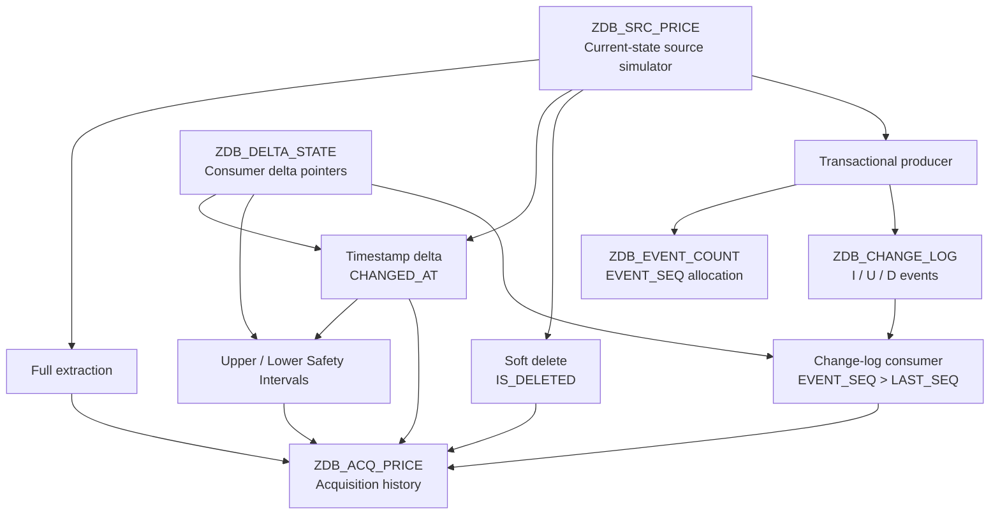

# ABAP Cloud Database Acquisition Lab

ABAP Cloud laboratory for studying database acquisition and generic delta semantics.

## Purpose

This project explores the reliability properties of database-based data acquisition.

The focus is not on reproducing the SAP BW DB Connect runtime, but on studying the source-side and consumer-side semantics that determine whether a database delta is reliable.

The laboratory covers:

- full extraction;
- numeric delta based on a creation sequence;
- timestamp-based delta;
- delayed COMMIT and transaction visibility;
- upper and lower safety intervals;
- physical and soft deletes;
- transactional change logs;
- monotonic event sequencing;
- producer concurrency;
- consumer restart;
- transactional rollback and recovery.

The project was built in SAP BTP ABAP Environment and uses local ABAP Cloud tables to simulate an external database source.

## Scope and Limitations

This project does **not** implement SAP BW DB Connect.

It does not contain:

- a DB Connect source system;
- BW DataSources;
- InfoPackages;
- PSA runtime;
- DTPs;
- ADSOs;
- Process Chains;
- a real external Oracle, SQL Server, DB2, PostgreSQL, or other remote database connection.

Instead, `ZDB_SRC_PRICE` acts as a controlled current-state source table so that delta behavior can be reproduced and tested deterministically.

The project concentrates on the semantic boundary:

```text
database source
      |
      v
delta extraction logic
      |
      v
acquisition persistence
```

## Architecture

The laboratory uses `ZDB_SRC_PRICE` as a controlled current-state source table that represents an external database table or view.

Two alternative delta architectures are implemented on top of this source:

1. **Timestamp-based delta**
2. **Transactional change-log delta**

Both approaches persist extracted data in `ZDB_ACQ_PRICE`, which acts as a lightweight acquisition-history layer for the laboratory.



## Experiments

The project is organized around a sequence of controlled experiments.

Each experiment starts from a simple acquisition strategy, introduces a specific source-side or transaction failure mode, and observes whether the consumer can still advance its delta pointer without losing data.


### 1. Full Extraction

The initial baseline reads the complete current-state source table:

```text
ZDB_SRC_PRICE
      |
      | FULL SELECT
      v
ZDB_ACQ_PRICE

```

### 2. Numeric Delta on a Current-State Table

The first delta strategy uses the monotonically increasing source field `CREATED_SEQ`.

The consumer stores the last successfully processed value in `LAST_SEQ` and reads only rows satisfying:

```text
CREATED_SEQ > LAST_SEQ
```

The source is initially prepared with the following current-state records:

```text
P1001/SOUTH  CREATED_SEQ = 1001
P1002/SOUTH  CREATED_SEQ = 1002
P1003/SOUTH  CREATED_SEQ = 1003
P1001/NORTH  CREATED_SEQ = 1004
```

The numeric delta pointer is then initialized to:

```text
LAST_SEQ = 1004
```

Two source changes are performed in one transaction.

A new row is inserted:

```text
P1004/SOUTH
PRICE       = 40.00
CREATED_SEQ = 1005
```

An existing row is also updated:

```text
P1001/SOUTH
PRICE       10.00 -> 12.00
CREATED_SEQ remains 1001
```

The numeric delta reader selects:

```text
CREATED_SEQ > 1004
```

and therefore returns only:

```text
P1004/SOUTH
CREATED_SEQ = 1005
```

The update of `P1001/SOUTH` is not detected because its creation sequence does not change.

Result:

```text
INSERT -> detected
UPDATE -> not detected
```

The experiment demonstrates that a monotonically increasing creation sequence is suitable for append-only acquisition, but is not sufficient for a mutable current-state table.

The important distinction is:

```text
CREATED_SEQ
= identity/order of row creation

not

= identity/order of every business change
```

After the successful acquisition, the consumer pointer advances from:

```text
LAST_SEQ = 1004
```

to:

```text
LAST_SEQ = 1005
```

Only data actually persisted in the acquisition layer is allowed to advance the pointer.
### 3. Timestamp Delta

The second delta strategy uses the source field `CHANGED_AT`.

Unlike `CREATED_SEQ`, this field is updated whenever a relevant source row is inserted or changed.

The source is first prepared with a common baseline timestamp:

```text
CHANGED_AT = T0
```

for all existing rows.

The timestamp delta pointer is then initialized to:

```text
LAST_CHANGED_AT = T0
```

Two source changes are performed in one transaction.

An existing row is updated:

```text
P1001/SOUTH
PRICE       12.00 -> 13.00
CREATED_SEQ remains 1001
CHANGED_AT  = T1
```

A new row is also inserted:

```text
P1005/SOUTH
PRICE       = 50.00
CREATED_SEQ = 1006
CHANGED_AT  = T1
```

Both changes intentionally receive the same timestamp.

The timestamp delta reader selects:

```text
CHANGED_AT > LAST_CHANGED_AT
```

and therefore returns both rows:

```text
P1001/SOUTH
PRICE      = 13.00
CHANGED_AT = T1

P1005/SOUTH
PRICE      = 50.00
CHANGED_AT = T1
```

Result:

```text
INSERT -> detected
UPDATE -> detected
```

The important difference from the numeric creation-sequence delta is that the existing row `P1001/SOUTH` is detected even though:

```text
CREATED_SEQ = 1001
```

remains unchanged.

The delta criterion is now based on the time of the latest relevant modification rather than on the time or order of row creation.

The experiment demonstrates that timestamp-based delta can detect both inserts and updates on a mutable current-state table, provided that the source reliably updates `CHANGED_AT` for every relevant business change.

After the successful acquisition, the consumer pointer advances from:

```text
LAST_CHANGED_AT = T0
```

to:

```text
LAST_CHANGED_AT = T1
```

The implementation stores the acquired rows and advances the timestamp pointer in the same database transaction.

At this stage the algorithm is intentionally naive:

```text
CHANGED_AT > LAST_CHANGED_AT
```

No safety interval is used yet.

This makes the reader suitable for demonstrating the next failure mode: a source change may receive an earlier `CHANGED_AT` value but become visible only after a delayed `COMMIT`, allowing the consumer pointer to advance past it.

### 4. Delayed COMMIT Failure

A two-session experiment is used to demonstrate a failure mode of the naive timestamp-delta algorithm.

The consumer currently uses:

```text
CHANGED_AT > LAST_CHANGED_AT
```

with no safety interval.

The initial consumer pointer is:

```text
LAST_CHANGED_AT = T0
```

In Session B, an existing source row is updated:

```text
P1002/SOUTH
PRICE       20.00 -> 23.00
CHANGED_AT  = T1
```

The transaction is intentionally paused before `COMMIT`.

At this point the row has already received `CHANGED_AT = T1`, but the updated version is not yet visible to other sessions.

While Session B is still uncommitted, Session A inserts another row and commits immediately:

```text
P1008/SOUTH
PRICE       = 80.00
CHANGED_AT  = T2
```

with:

```text
T1 < T2
```

The naive timestamp reader runs in Session A.

It can see the committed row at `T2`, but it cannot see the still-uncommitted update at `T1`.

The reader therefore selects:

```text
P1008/SOUTH
CHANGED_AT = T2
```

and advances the consumer pointer to:

```text
LAST_CHANGED_AT = T2
```

Session B is then resumed and commits the older change:

```text
P1002/SOUTH
CHANGED_AT = T1
```

The row is now committed and visible, but its timestamp is already behind the consumer pointer:

```text
T1 < LAST_CHANGED_AT = T2
```

The next timestamp-delta request uses:

```text
CHANGED_AT > T2
```

and therefore does not select `P1002/SOUTH`.

Result:

```text
P1008/SOUTH -> acquired
P1002/SOUTH -> permanently missed
```

The failure is not caused by an incorrect source timestamp.

`P1002/SOUTH` received a valid `CHANGED_AT = T1` before the transaction committed.

The problem is that:

```text
time of change
!=
time at which the change becomes visible to the extractor
```

The experiment demonstrates that a naive timestamp delta can lose committed source changes when transaction visibility is delayed.

The critical sequence is:

```text
T1
P1002 updated
CHANGED_AT = T1
transaction still uncommitted

T2
P1008 inserted and committed

consumer reads source
P1008 is visible
P1002 is not visible

consumer pointer -> T2

later
P1002 commits with CHANGED_AT = T1

next request:
CHANGED_AT > T2

P1002 is never selected
```

Changing the selection condition from:

```text
CHANGED_AT > LAST_CHANGED_AT
```

to:

```text
CHANGED_AT >= LAST_CHANGED_AT
```

does not solve this failure mode because:

```text
T1 < T2
```

rather than:

```text
T1 = T2
```

This experiment motivates the use of an upper safety interval.


### 5. Upper Safety Interval

The delayed-COMMIT experiment shows that a naive timestamp delta can advance its pointer beyond a source change that is still uncommitted and therefore temporarily invisible.

To reduce this risk, the safer timestamp reader introduces an upper safety interval.

Instead of reading up to the current request time, the reader defines:

```text
UPPER_BOUND =
REQUEST_START - UPPER_SAFETY_INTERVAL
```

For example:

```text
REQUEST_START          = 12:30:00
UPPER_SAFETY_INTERVAL  = 00:05:00

UPPER_BOUND            = 12:25:00
```

The consumer then reads only:

```text
LAST_CHANGED_AT < CHANGED_AT <= UPPER_BOUND
```

All source changes newer than `UPPER_BOUND` remain temporarily outside the extraction window.

This creates a deliberate safety zone:

```text
                         safety zone
                             |
                             v
-----------------------------|-------------------->
                       UPPER_BOUND           REQUEST_START
```

The delayed-COMMIT experiment is repeated.

Session B performs:

```text
P1002/SOUTH
PRICE       20.00 -> 23.00
CHANGED_AT  = T1
```

and pauses before `COMMIT`.

Session A then inserts and commits:

```text
P1008/SOUTH
PRICE       = 80.00
CHANGED_AT  = T2
```

with:

```text
T1 < T2
```

Both timestamps are still inside the upper safety zone when the safe reader runs.

Therefore the reader does not select either row yet.

Instead, it advances the persistent pointer only to the safe upper boundary:

```text
LAST_CHANGED_AT = UPPER_BOUND
```

The important difference from the naive reader is that the pointer is no longer derived from:

```text
MAX(CHANGED_AT) of currently visible rows
```

It represents:

```text
the latest time boundary that has been safely scanned
```

Session B is then allowed to commit.

After enough time has passed, the next request calculates a later `UPPER_BOUND`.

Both source changes now fall inside the safe extraction interval:

```text
LAST_CHANGED_AT < T1 <= UPPER_BOUND
LAST_CHANGED_AT < T2 <= UPPER_BOUND
```

and both rows are acquired successfully.

Result:

```text
Naive timestamp delta
-> late-committed row lost

Timestamp delta with upper safety
-> late-committed row acquired later
```

The experiment demonstrates that the upper safety interval protects the consumer from advancing too close to the current time, where source transactions may still be incomplete.

The trade-off is additional latency:

```text
larger upper safety interval
-> stronger protection against delayed visibility
-> older data delivered to the consumer
```

The configured interval must therefore be compatible with the source transaction behavior.

For the timestamp architecture to be reliable, the delay between:

```text
assigning CHANGED_AT
and
the transaction becoming committed and visible
```

must be bounded.

The upper safety interval must be large enough to cover that expected visibility lag.

If source transactions can remain uncommitted for an arbitrarily long time, no finite upper safety interval can provide a strict lossless guarantee.

This limitation is one of the main differences between timestamp-based delta and the transactional change-log architecture explored later in the project.
### 6. Lower Safety Interval
### 7. Physical vs Soft Delete
### 8. Transactional Change Log
### 9. Producer Concurrency
### 10. Consumer Restart
### 11. Producer Rollback on Log Failure

## Timestamp Delta vs Transactional Change Log

## Data Model

## Main Classes

## How to Run

## Mapping to SAP BW DB Connect

## Project Limitations

## Key Takeaways
